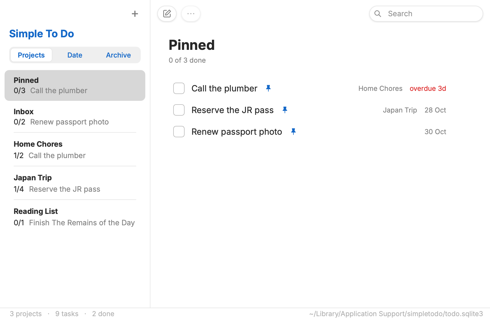
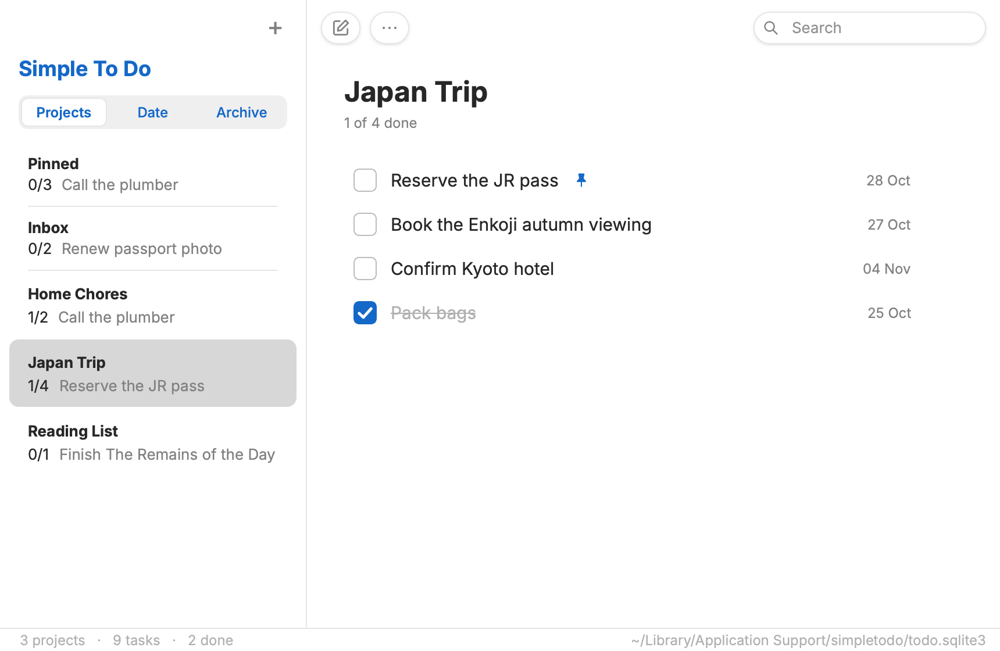
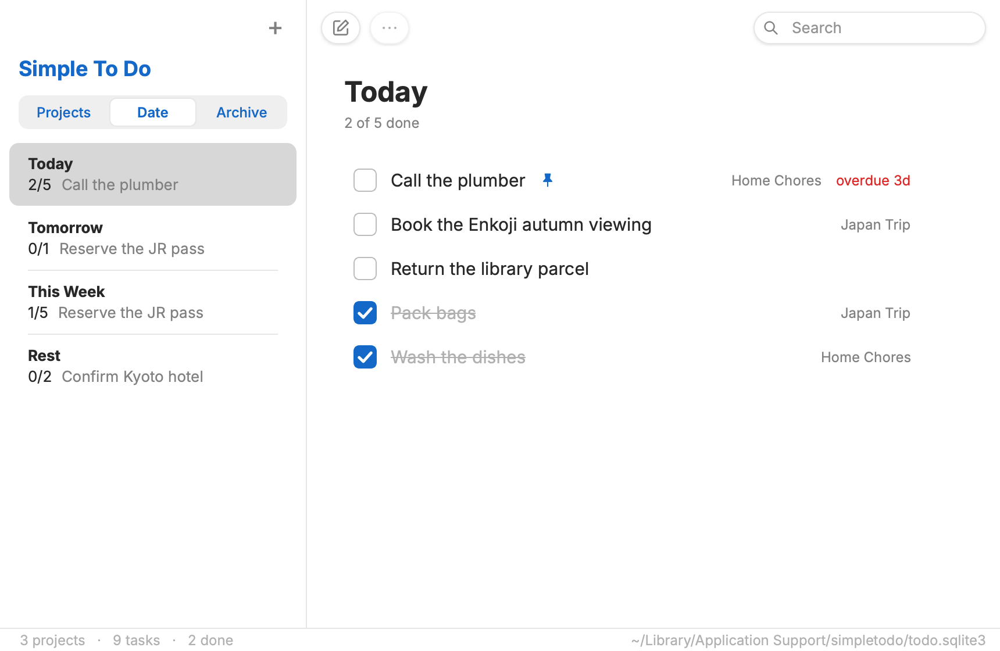

# SimpleTodo

A minimalist to-do app for macOS and Ubuntu. It works entirely offline: no
accounts, no network calls, no telemetry. Your tasks are stored in one SQLite
file on your own disk.



## Download (macOS, Apple Silicon)

Download `SimpleTodo-1.2.0-macos-arm64.zip` from the
[latest release](https://github.com/boredtoolbox/simpletodo/releases/latest),
unzip it, and drag `SimpleTodo.app` into Applications. The app is unsigned, so
the first time you open it, right-click it and choose **Open**. If macOS still
blocks it, go to System Settings → Privacy & Security and click **Open Anyway**.

If macOS says the app "is damaged and can't be opened", the file is fine.
macOS has flagged it as downloaded from the internet. Clear that flag with:

```bash
xattr -dr com.apple.quarantine /Applications/SimpleTodo.app
```

## Run from source (macOS and Ubuntu)

You need Python 3.10 or newer.

```bash
git clone https://github.com/boredtoolbox/simpletodo.git
cd simpletodo
python3 -m venv .venv
.venv/bin/python -m pip install -r requirements.txt
.venv/bin/python run.py
```

The only dependency is PySide6 (Qt 6). The app is set in
[Inter](https://rsms.me/inter/), bundled under the SIL Open Font License
(`simpletodo/ui/assets/fonts/LICENSE.txt`).

If pip says it "can not perform a '--user' install", run the install line as
`PIP_USER=0 .venv/bin/python -m pip install -r requirements.txt`.

### macOS app (optional)

To build a double-clickable `SimpleTodo.app`:

```bash
.venv/bin/python -m pip install -r requirements-build.txt
.venv/bin/python -m PyInstaller packaging/SimpleTodo.spec --noconfirm
```

Then drag `dist/SimpleTodo.app` into Applications. The app is unsigned, so the
first time you open it, right-click it and choose **Open**.

## Using it

- **+** (top of the sidebar) creates a project or a task. The pencil button
  above the tasks adds a task; the dialog starts on the project you used for
  your last task, so a run of tasks needs no re-picking. **⋯** renames,
  archives or deletes that project, and **Search** filters the tasks shown.
- Ticking a task strikes it through.
- The switch under the title picks what the sidebar lists. **Projects** lists
  your projects; select one to see its tasks on the right. Tick a checkbox to
  complete a task, and click a task's name to read its description.
- A task doesn't need a project: choose **Inbox** as its project and it is
  listed under **Inbox** at the top of the sidebar.
- **Pin** a task from its **⋯** menu to keep it in view. Pinned tasks are
  gathered under **Pinned** at the top of the sidebar, which is where the app
  opens, and they come first in their own project too.
- **Date** lists Today, Tomorrow, This Week and Rest. Overdue tasks show up in
  Today, in red.
- **Archive** lists archived projects, where you can restore them. Esc goes
  back to the view you came from.
- Hover a project or task and click **⋯** (or right-click it) to rename,
  delete or archive it. A task's menu also has **Move to**, to send it to a
  different project or to the Inbox. The arrow keys move through the sidebar.

<p>
  
  
</p>

## Your data

| Platform | Location |
| --- | --- |
| macOS | `~/Library/Application Support/simpletodo/todo.sqlite3` |
| Linux | `~/.local/share/simpletodo/todo.sqlite3` (respects `$XDG_DATA_HOME`) |

To store it somewhere else, set `SIMPLETODO_DATA_DIR`. Every change is saved
immediately. If the file is ever damaged, the app keeps a backup copy
(`todo.sqlite3.corrupt-<timestamp>`) and starts a fresh database.
A database from an earlier version is upgraded once, the first time a newer
version opens it; its folder must be writable for that.

## Development

```bash
.venv/bin/python -m pytest
```

The screenshots above come from the real window, filled with sample tasks:
`.venv/bin/python tools/readme_screenshots.py` regenerates them in `docs/`.
